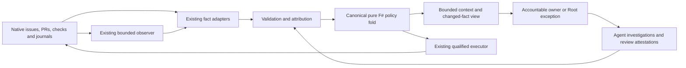

# Deterministic F# coordination engine

Date: 2026-11-03. Status: proposed implementation design; this document changes no runtime authority, policy, schema or installed caller. Owning programme: [COORD-EFF-02, #4730](https://github.com/FS-GG/.github/issues/4730). Implementation intake follows design merge and fresh deduplication.

## Purpose and boundaries

Make ordinary authorized delivery advance without repeatedly asking Root to interpret the same control instructions. A deterministic F# policy fold should select useful next actions from attributed facts; existing qualified tools execute them, and accountable agents supply engineering judgment. Root sets priorities and handles genuine exceptions. Each Delivery keeps one owner through its complete acceptance, with one integrator for shared surfaces.

This extends the existing coordination engine. GitHub issues, parent links and Project 3 remain planning authority; native PRs and checks establish source delivery; existing operation journals retain effect custody. No second scheduler, backlog, acceptance ledger, approval service or persistent agent per phase is introduced. A decision is advice to an authorized execution boundary, never a grant.

The initial product covers four useful cases: resume existing owned work, select an executable Delivery within actual capacity, advance an already authorized sequence, and surface a scoped exception or reopening condition. Broad automatic interpretation of acceptance prose is outside that boundary. Hardness classifications remain advisory while their validity across models and effort levels is unestablished.

## Existing capabilities and the extension seam

The source baseline inspected for this design is protected commit `6554ee0cc2fce04677b731a7b01972c0346e45c2`. Relative source links navigate the repository; the immutable baseline is available through that commit.

| Existing surface | Present responsibility | Proposed extension |
|---|---|---|
| [V2ProjectionSource](../../src/FS.GG.Coord.GitHub/V2ProjectionSource.fsi) | Native inspection, attributed slice joins, reservations, capacity and pure `selectActions`; selection folds an explicit integrator order and does not dispatch or accept effects | Keep one canonical selector; add typed reasons, explicit policy ordering and continuation decisions at this seam |
| [V2Preflight](../../src/FS.GG.Coord.GitHub/V2Preflight.fsi) | Closed supported-route checks, distinct supported/unsupported/unknown results and live versus supplied facts | Reuse registered checks; register missing stages through ordinary qualification, never interpret an unregistered route as supported |
| [OperationObservation](../../src/FS.GG.Coord.Core/OperationObservation.fsi) and [native reads](../../src/FS.GG.Coord.GitHub/OperationObservationReads.fsi) | Bounded observation of an admitted original, durable charged budgets and meaningful attention | Reuse original cursors and terminal events; no new polling daemon |
| [ContextView](../../src/FS.GG.Coord.Core/ContextView.fsi) and [native reads](../../src/FS.GG.Coord.GitHub/ContextViewReads.fsi) | Pure bounded views, verbatim obligations, explicit gaps and whole-section omissions | Project the selected decision and changed determining facts through the same view |
| [StructuredDecision](../../src/FS.GG.Coord.Core/StructuredDecision.fsi) | Content-addressed attributed route/review records with source and succession | Reuse compatible provenance conventions; URL presence alone authenticates nothing; do not revive retired V1 scheduling |
| [Routine delivery](routine-delivery-evidence.md), [creation helper](../../tools/pr-lane-admission.py) and [delivery helper](../../tools/routine-delivery.py) | Qualified source admission, native checks and effect execution/readback | Executor calls these boundaries; it does not reproduce their checks in a new writer |
| [Board design](2026-09-29-coordination-v2-board-design.md) and [canonical lifecycle](../../.agents/skills/work-board/references/lifecycle-contract.md) | Native work levels, acceptance, intake and protected mutations | Retain the existing planning model and qualified writer |

The current selector charges its five-minute freshness bound from the earliest inventory read, not from the last response. Preserve that constraint until a separately tested freshness policy replaces it. Source implementation may tolerate review/check availability gaps when identity and scope remain current; binding and membership gaps retain their broader effect.

The existing selector's `CurrentSlice`, `SliceJoin`, `AttributedObservation`, `SelectionContext` and `Reservation` already bind owner, attempt, operation, issue/body/hierarchy revision, enrollment, head and evidence. The new contracts must map these fields explicitly, preserve their unknown values and compare old/new outcomes during migration. Do not put another selection algorithm beside `selectActions` and let both dispatch.

[ADR-0096](../adr/0096-proportionate-verification-and-unrecoverable-holds.md) already permits ordinary isolated local verification without Root runtime approval, original clocks or custody packets. It also permits conditional advancement within a reviewed finite protected envelope. This design makes those distinctions executable and prominent; it does not invent the permission. [ADR-0084](../adr/0084-semantic-reuse-never-cancels-coherent-validation.md) continues to govern coherent validation. [ADR-0097](../adr/0097-one-org-wide-serialized-publication-writer.md) remains authoritative for publication serialization until a separately accepted policy and code change.

## Architecture and ownership



A tested library owns decisions; a thin existing CLI/application surface supplies IO, policy revision and facts. An `.fsx` convenience entrypoint, if useful, calls the same library. It owns neither alternate policy nor credentials. Initial module placement is the existing Core/GitHub split: pure domain types and ordering in Core, GitHub-specific joins in `V2ProjectionSource`, existing CLI composition at the edge. The exact extraction must avoid a Core dependency on GitHub adapters.

The coordinator alone allocates new owners and integrates competing touch sets. Owners implement, verify, repair, obtain proportionate independent review and complete permitted delivery steps. Contributors can investigate disjoint components, but an agent return does not transfer accountability or create a new planning row. Independent reviewers attest only to their reviewed source and scope. Agents cannot self-issue trusted native observations or extend authority by increasing confidence.

Root chooses priority policy, resolves conflicting promises and admits genuine changes to protected scope. Ordinary local checks and successful steps within existing bounds stay with the owner. A blocked parent or sibling does not automatically block an independent action.

## Typed facts and epistemic limits

A fact separates claim, authenticity, completeness, freshness and judgment. The implementation should use closed claim cases for determining inputs; arbitrary strings can carry explanation but cannot satisfy an executable predicate. Suggested types below are illustrative design contracts, not compilable API guidance or deployed schema.

```fsharp
type Support =
    | NativeObservation of adapterId: string * evidenceDigest: string
    | AgentAttestation of supplierId: string * attestationId: string
    | Reported of sourceRef: string

type Knowledge<'a> =
    | Known of 'a
    | Unknown of reasonCode: string
    | Conflict of factIds: string list

type Fact<'claim> = {
    Id: string
    Subject: string
    Claim: Knowledge<'claim>
    Support: Support
    ObservedAt: System.DateTimeOffset
    ValidUntil: System.DateTimeOffset option
    Revision: string
    ScopeDigest: string
    EvidenceRefs: string list
    Supersedes: string list
}
```

`Revision` denotes the relevant native revision or immutable artifact, not merely the collector checkout. `ScopeDigest` binds applicable issue/body/acceptance, dependency population, source/head/base, enrollment and policy operands through a typed subject-specific record. Different claim types need different operands; a single blanket hash must not conceal their absence. UTC timestamps support comparison and reporting; original execution deadlines retain their existing monotonic clock domain and boot/namespace identity.

| Dimension | Required treatment |
|---|---|
| Provenance | Collector identity/version, authenticated source, collection window, source revision, evidence digest and retrieval pointer; no credential values |
| Completeness | Page boundaries, expected population and missing suppliers explicit; zero results on an incomplete read do not establish absence |
| Freshness | Claim-specific policy; immutable bytes remain reusable by identity, mutable determining inputs refresh beside execution; clock skew or a future timestamp yields a gap |
| Confidence | Native observation, attestation, reported or unknown are epistemic categories, not a numeric permission ladder; optional calibrated judgment probability is separate |
| Conflict | Retain competing claims and their scope; resolve by authoritative source/explicit supersession, never newest timestamp or majority vote alone |
| Privacy | Public projection carries safe references and typed gaps; restricted raw evidence stays in existing private custody with access controls |

An agent attestation binds supplier, role, requested and observed model/effort where available, exact reviewed subject, method, evidence, uncertainty, conflicts of interest and scope limitations. Missing actual model metadata remains unknown. Review independence must be checked against ownership and contribution, not inferred from a different session name. An attestation that CI passed asks the native adapter to verify the exact run/check population; it cannot replace required Checks evidence. A semantic acceptance attestation may establish its specific criterion when the acceptance policy names that reviewer role, but not publication or runtime facts it did not observe.

Facts are inert input. Text in issue bodies, external evidence and agent explanations is untrusted data and cannot supply new policy or instructions. Decoders bound document size, nesting, collection counts and text lengths; reject duplicate identities, invalid timestamps, malformed digests and unsupported schema versions before decision evaluation.

## Reconstructible state and deterministic decisions

The engine receives a snapshot, never silently reads a clock or network. Determinism means equal canonical policy, explicit time, facts and continuation input produce equal ordered decisions and serialized bytes. Sort by stable identifiers where native order is semantically irrelevant; preserve explicit policy order where it matters. Version canonical encoding and hashes. Avoid random selection and machine-dependent map iteration.

Native state is authoritative. A projection cache stores fact dependencies, observation cursors and last emitted semantic digests for efficient resumption. It can be deleted and rebuilt from issues, source, native effects and existing journals. It cannot establish ownership, release reservations or close an issue. A cache/source schema mismatch forces reconstruction or a scoped refusal; it never resets an original execution budget.

The snapshot distinguishes:

- Outcome acceptance from child status and Delivery acceptance from PR merge;
- ownership from active execution, source work from publication/installed/runtime work;
- running, paused, stopped, and reported-but-unverifiable operations;
- definite pre-send failure, sent/pending, confirmed effect, uncertain effect and reconciled original;
- ready, blocked on a named input, awaiting native progress, and needing judgment.

Proposed interface shape:

```fsharp
// Proposed successor behind the canonical selection seam; no IO.
decide : Policy -> Snapshot -> FactSet -> ExplicitTime -> DecisionBatch

type NextAction = Resume | Implement | Verify | Review | Deliver | Reconcile

type Decision =
    | ContinueOwner of delivery: string * action: NextAction
    | Dispatch of delivery: string * profile: string
    | ObserveOriginal of operation: string
    | Await of subject: string * reopeningCondition: string
    | RequestJudgment of subject: string * question: string
    | ProposeAcceptance of delivery: string * criterionEvidence: string list
```

Every decision envelope includes schema/policy version, canonical decision ID, subject/owner/attempt, input digest, reason codes, determining fact IDs, applicable grant reference, preconditions, required refreshes, resource demand, superseded decision ID and next meaningful event. `ProposeAcceptance` deliberately requires executor-side verification and the existing acceptance route; it performs no closure. Missing acceptance judgments produce `RequestJudgment`, never guessed success.

Decision precedence is explicit: unresolved relevant effects select original observation/reconciliation before another send; invalid scope or authority blocks that action; missing determining facts select targeted refresh or judgment; eligible owned work precedes new dispatch. A single batch must not both await a necessary input and execute an action requiring it. Independent actions may coexist, with capacity charged once.

Internal lifecycle states are derived views, not another editable workflow. Replaying a decision does not execute it. A consumed or superseded decision cannot be treated as a fresh send. No-op decisions explain unchanged holds internally without generating new issue comments.

## Priority, dependencies and resource admission

First filter by scope, enrollment or explicit pending-batch admission, ownership, satisfied action-specific dependencies, authority and relevant resource feasibility. Then rank eligible actions with a versioned lexicographic policy: user priority, finish already owned acceptance, unblock shared prerequisites, aging/neglected work, and stable native identity as final tie breaker. Overrides state their reason and scope. Hardness and estimated speed cannot suppress difficult product work or compensate for an unmet safety predicate.

Use a typed dependency graph: acceptance dependency, source contract, resource conflict, supplier judgment and effect readback are distinct edge kinds. Each edge names the assertion it blocks, supplier and reopening condition. Detect cycles and orphan suppliers; request one actionable decision rather than repeatedly waiting on a cycle. A dependency omitted from an incomplete hierarchy remains unknown. Bound graph size, facts, events per batch, output bytes and native requests; an exhausted bound returns a typed gap and durable continuation pointer, not a partial positive decision. Recompute the affected reverse dependency closure on change; perform full membership/hierarchy reconciliation at startup, integrity intervals and membership gaps.

The current capacity contract means remaining-after-active slots, not total host slots. Mapping it into richer resource vectors must avoid subtracting active demand twice. An existing reservation may exempt only its exact slice, attempt, operation, owner, repository, paths, PR and head; an equal owner name is insufficient.

Resource demand includes workers, review/integration attention, CPU, memory, swap, tasks, disk/temp headroom, hosted CI and actual write domains. Count transitive workflows and setup/cleanup demand, not just the visible parent job. Existing uncertain reservations retain their exact scope. An expired observation is not a released reservation. Repository/path conflicts use the current qualified overlap rules; more granular independence requires demonstrated isolation and one shared-surface integrator.

Admission folds selected work into remaining capacity before considering the next candidate. Existing-PR observation adds no implementation slot; parked PRs and active CI differ in proposed resource accounting. Current PR caps and publication serialization remain enforced until their policy and tools change together. Capacity cannot be invented from free agent slots. Unknown demand blocks only actions whose safety depends on it; read-only or disjoint source preparation can proceed when their own determining facts establish independence.

Concurrent invocations serialize reservation acquisition through the existing lock/qualified writer boundary, reread occupancy there and reject stale admission. The pure fold has no lock and does not claim native multi-object atomicity. Prevent starvation by reporting aged eligible work and exhausted resource classes; tune ranking from pilot evidence rather than adding another schedule.

## Standing authority and execution

The operating guide should begin with owner autonomy and the exception boundary. Ordinary isolated verification follows ADR-0096 directly, within the stated resource share, preserving first failures. Do not require a synthetic grant, operation clock or pre-run approval for that class.

For protected effects, consume the existing reviewed finite envelope: owner, exact permitted sequence, source and immutable inputs, actual credential/runtime context, write domains, independent original IDs/clocks, aggregate horizon, success predicates and readback/cleanup bounds. An engine decision references this evidence; it cannot mint or renew it. Result-derived inputs must follow an exact derivation already covered by the envelope. Stop before an unreviewed input or action.

Execution proceeds at the existing boundary:

1. Validate the decision's scope and policy version; refresh mutable determining facts and actual authority/revocation beside the effect.
2. Recheck resources and relevant reservations under the existing guard. Preserve exact-source/CI/independent review and native writer requirements.
3. Use the existing operation intent/custody before send where required; keep the original identity and deadline.
4. Execute once through the qualified adapter. Retain response or transport failure with send certainty.
5. Independently read back the affected native state and protected operands. Advance the same owner only after the specified verified result.

A decision ID supports correlation; it is not an idempotency key unless the native endpoint actually guarantees that behavior. Precondition checks do not create an atomic compare-and-swap on an API without one. Document the race and its existing guard/readback behavior. Native PR creation, board mutation, merge, publication and installation each retain their separate effects and acceptance.

### Uncertain-effect recovery

| Observed result | Permitted continuation |
|---|---|
| Known failure before send | Preserve failure; a corrected fresh action requires its own applicable authority, not an assumed retry |
| Confirmed success and required readback | Advance the covered sequence if inputs, horizon and authority remain valid |
| Timeout/connection loss after possible send | Observe and reconcile the original operation, retaining reservation and uncertainty |
| Conflicting readback or determining drift | Stop the affected branch, retain original evidence and request reconciliation/judgment |
| Exhausted original deadline or expired grant | No renewed clock or replacement-ID replay; reconcile and obtain explicit continuation authority where needed |
| Other unrelated work | Continue only when its isolation and own prerequisites are established |

On restart recover original journal IDs, actual owner, cursor budgets and unresolved sends before selecting new work. Missing journals are unknown custody, not proof that nothing happened. The engine may propose observation; it may never infer safe resend from cache loss, elapsed time, an empty queue or missing service metadata. Retiring a watcher does not prove the watched actor or its effects retired.

## Events, evidence reuse and reporting

Use existing native changes and bounded observers as triggers: owner result, PR head/base or check change, dependency result, capacity release, authority change, deadline or membership change. Events are hints to refresh authoritative facts. Deduplicate repeated events by native identity/revision and use bounded coalescing for bursts; out-of-order or missing events require targeted reconciliation and periodic integrity reads. No new polling scheduler is needed.

One observer owns each awaited condition within its original budget. Unchanged ticks remain internal. Return attention for completion, failure, drift, unknown, interruption or exhausted bounds. A wait records supplier, last successful complete observation, deadline and precise reopening predicate in the existing owning record. The engine does not create model turns to announce unchanged waits. Unobserved external deadlines can be reported as pending but not automatically extended.

Reuse evidence by a typed dependency key: validated tool/policy version, exact subject/source, inputs/environment, criterion and provenance. Reuse immutable facts only when those operands match. A changed head invalidates head-specific qualification; a moved base invalidates the checks whose contracts depend on that base. Unrelated metadata does not logically invalidate immutable artifact bytes, but current required workflow evidence still applies. ADR-0084 coherent validation cannot be replaced by a collection of individually unchanged files.

Keep PR references and scope declarations stable where future policy permits; bind exact heads through native CI. Today the managed helper binds metadata to a head. Replacing that behavior requires coordinated helper, gate, policy and test changes. Likewise the helper currently lacks a draft-create argument although the skill expects drafts until checks pass: implement draft creation in the canonical helper and verify native draft state, rather than codifying a permanent create/convert workaround.

Report accepted progress, changed blockers, required decisions and exhausted bounds. Use the existing context view, preserve verbatim Done when, list omissions and provide evidence pointers. Equal Status is a quiet no-op. Update Delivery meaning first, reassess Outcome only when remaining scope or acceptance changes. All children Done is a prompt to assess the Outcome, not automatic proof. Capture reusable Atlas findings alongside the delivery; do not manufacture a report PR for each unchanged observation.

## Wire contracts and examples

Proposed new documents use closed, independently versioned schemas `fsgg.coord.fact-set/1` and `fsgg.coord.decision-batch/1`. These names are reserved here as proposals; existing consumers must not accept them until registered and qualified. Reuse existing native/observer schemas instead of wrapping and copying their full payloads. Unknown fields follow explicit compatibility rules: reject unknown determining semantics, preserve supported optional display extensions, never silently drop a constraint.

| Document | Required contents |
|---|---|
| Fact set | Schema, collector/version, collection interval, population/completeness, subject-specific revisions, facts and gaps, safe evidence pointers, canonical digest |
| Decision batch | Schema, policy/source/contract versions, snapshot and fact digests, explicit time, ordered decisions, determining facts, reasons, refresh requirements and omissions |
| Agent attestation | Supplier and role, exact subject/revision/criterion, method, evidence, epistemic category, uncertainty, independence and actual model metadata or unknown |
| Continuation projection | Source identities, dependency index, last semantic output and pointers to existing original cursors/journals; no duplicate authority or effect journal |

Illustrative decision fragment (not a deployed command or full schema instance):

```json
{
  "schema": "fsgg.coord.decision-batch/1",
  "policyRevision": "policy-content-digest",
  "snapshotDigest": "canonical-snapshot-digest",
  "decisions": [{
    "kind": "continue-owner",
    "subject": "FS-GG/example#42",
    "owner": "existing-owner",
    "attempt": "existing-attempt",
    "action": "verify",
    "reasonCodes": ["owned-work", "isolated-local-verification"],
    "determiningFacts": ["scope-fact", "isolation-fact", "capacity-fact"],
    "authorityClass": "adr0096-ordinary-verification",
    "grantRef": null,
    "nextEvent": "verification-result"
  }]
}
```

Examples that must become fixtures:

- An owner edits unpublished F# in an isolated worktree. Available resource share and isolated outputs permit a local test immediately. No Root runtime approval is requested; first test failure stays with the owner for repair.
- Native CI becomes green at the selected head. A current independent review and existing delivery authority permit the next qualified route. If its base/policy join is stale, refresh that join, rather than accepting the agent's summary or globally rebuilding unrelated evidence.
- A merge response is lost. Emit observation of the same original. Native merge/tree/readback resolves it if possible; no second merge send or replacement journal is generated.
- Two Deliveries have disjoint code but share a generated contract. Source preparation can overlap; one integrator owns the generated surface and qualification capacity is reserved once.
- Eight children are Done while the Outcome still requires installed use. Request the missing installed acceptance; do not close the Outcome by counting children.
- An archive invocation is manually verified and its permanent timer is enabled, but acceptance requires the first natural run. Await that run and independent readback; do not relabel the manual invocation as scheduled evidence or start another run merely to finish the card.
- One supplier attests acceptance while native CI reports failure. Keep the semantic attestation within scope and block source delivery on the native failure; confidence does not resolve the conflict.

## Validation and historical replay

Use normal F# unit/property testing and the repository's existing integration fixtures. Add tests that attack actual policy consequences, not serialized mirrors of the implementation. No new model experiments or classifier study is a prerequisite for coordinator correctness.

Safety properties include: no effect from pure evaluation; no dispatch without native Delivery/scope admission; no unauthorized grant expansion; no acceptance from child count; unknown never satisfies a required predicate; no resend after uncertain send; no clock renewal or reservation release from expiry; exact original identity survives restart; independent review and coherent/exact-source validation remain required. Duplicate event delivery, cache deletion and input order permutations must not duplicate effects.

Liveness properties include: isolated authorized verification never escalates for Root runtime permission; verified successful covered steps advance without per-step approval; unrelated unknowns do not block demonstrably independent work; a finished observer returns once; a meaningful dependency event reopens the right work; aging eligible work remains visible. Tests must fail if the engine becomes safe only by indefinitely deferring everything.

Contract tests exercise actual codecs, native pagination, policy unavailable versus empty, missing credentials, stale/future timestamps, supersession conflicts, collection churn and closed route registration. Executor integration tests use sandbox/fake endpoints for send/readback fault injection, and separately qualify the existing real adapter against one necessary bounded operation. Test crashes before intent, after intent, after send and before readback; transport faults; concurrent admission; expired authority; partial native writes; stale caches; out-of-order events and replay after upgrade. Keep original failures and unknown outcomes.

For formal state-machine work, follow the existing [Quint-first authority](../adr/0077-quint-first-typed-specification-authority.md): build or extend the owning canonical model before claiming formal verification. Existing ADR-0077 qualification and backend-authority gates remain unchanged; a proposed model cannot self-qualify its verifier or authorize production execution. Model authority, reservations, uncertain sends, restart and continuation; run consistency/type checks, executable invariants and bounded verification with stated bounds. F# trace replay checks refinement against the selected contract. Passing finite exploration is not a proof of all agent judgments or unbounded liveness. Specification changes trigger both consistency checking and implementation-impact review; semantic changes require new implementation/trace evidence. This design alone installs no new Quint model.

Historical replay uses existing issues, PRs, run histories, journals and progress reports, with point-in-time snapshots and explicit coverage. Freeze the replay cohort and policy before scoring; include successful, failed, interrupted, censored and unresolved cases. Later comments, current classifications and final durations must not leak into earlier decisions. Report which facts could not be reconstructed and score them as unknown, not false or zero. Historical replay is read-only and cannot create grants from retrospective knowledge.

The user-supplied side analysis reports a 27 October–2 November retrospective. Treat it as supplied analysis, not a recomputed pilot baseline. The [3 November report](../reports/progressReports/2026-11-03-024500Z-unified-v3-progress.md) and adjacent reports corroborate process patterns; they do not establish that weekly census. Native point-in-time replay must establish the comparison baseline. Native closure/merge counts differ from accepted Delivery throughput. Reported PR elapsed time includes pauses and external waiting. Stratify by repository, work type, pre-existing age, CI load and effect class. Completion-only comparisons are subject to survivorship bias; carry open work and follow-up windows. Exploratory slices must be labeled exploratory and validated on a separate time window.

## Migration, pilot and rollback

1. **Source inventory and contract mapping.** Confirm every proposed fact/decision against existing types, writers, policies, observers and native authority. Recover #4730 and related accepted children without reopening delivered scopes. Deduplicate implementation work, retaining full publication/installed/runtime obligations in one accountable Delivery or genuine acceptance-based children.
2. **Pure extension and replay.** Version the canonical selector successor; keep existing behavior as the production path. Add deterministic fixtures, safety/liveness properties, fault injection and point-in-time historical replay. No alternate dispatcher or writable shadow state.
3. **Read-only comparison.** Run the new fold on the same snapshots as current coordination for a bounded comparison period. Explain disagreements by input, policy or defect. Human disposition is required for a safety disagreement; agreement alone is insufficient if both paths share a bug. Comparison does not require an extra report on every tick.
4. **Qualified limited adoption.** Complete independent review, exact-head CI, ordinary PR merge and applicable coherent publication. Adopt an exact installed caller/instruction tuple for a named scope. A feature selection at the existing invocation chooses exactly one decision path. Source merge alone proves no live adoption.
5. **One-week pilot.** Use existing native records/telemetry and explicit start/end cohorts. Permit ordinary owner continuation and covered sequences through unchanged executors. Observe correctness and throughput; retain all failures, waits and rollbacks. Expand only after the acceptance review below.
6. **Consolidate instructions.** Change work-board-coord, common work-board core, pnext-item and lifecycle references together. Target a roughly 250–350-word coordinator adapter; detailed effect safeguards remain discoverable at the operation boundary. Remove repeated prose only when its executable replacement and adoption are verified. Instruction size is a usability measure, not a token-savings claim.

On defect or invalid policy, stop new decisions from the successor and select the prior qualified path for fresh actions through the same invocation. Reconstruct current state and original custody before resuming. Already sent effects are observed through their original handler/version; rollback must not resend, renew clocks, erase reservations or revert accepted native planning. A wire-breaking upgrade requires a supported decoder/migration or refusal; no downgrade may reinterpret an unknown schema as empty state. Retain old binaries needed to read originals. Test rollback during an uncertain effect, not only before any work starts.

Changes to draft creation, head binding, active-resource WIP and release serialization are separately qualified policy/tool deltas within the implementation plan, not privileges granted by this document. Preserve current behavior until each change has its own determining tests and adoption evidence. Immutable release snapshots can reduce unrelated main freezes only when current revocation, predecessor, authority and actual conflicting resource checks remain enforced.

## Acceptance and measurement

Measure from existing records; avoid creating a separate measurement programme. Instrument decision/effect correlation and waiting reasons in existing telemetry, excluding secrets and private payloads. Record coverage and attribution before interpreting rates. Establish a frozen preceding comparison window and the pilot cohort; account for starting WIP, work mix, interrupted work and external waits. Seven days is an operational pilot, not enough by itself for strong causal or cost claims.

| Measure | Definition and acceptance |
|---|---|
| Correctness | Zero observed unauthorized effects, duplicate uncertain sends, lost obligations/reservations or unsupported acceptance in qualification and pilot; any such defect stops expansion. All required source/CI/review/readback gates remain enforced |
| Determinism | Equal canonical inputs yield byte-identical decisions; independent serialization/order/restart tests pass |
| Owner autonomy | All covered fixture cases advance without redundant Root runtime approval; pilot records every unnecessary round-trip, with a target of zero within unchanged standing scope |
| Event overhead | Zero model wakeups for unchanged observer ticks in the covered pilot population; every return names a meaningful event, gap or exhausted bound |
| Throughput | Accepted Delivery completions per observation day and older-work retirement, with acceptance scope and open/censored population disclosed; no regression attributable to engine serialization |
| Latency | PR creation-to-merge median/p90 and coordinator-wait median/p90, separated from external/CI/owner waiting; target lower coordinator waiting than the comparable baseline |
| CI demand | Runs and hosted job-minutes per merged PR, counting failed/cancelled/repeated runs; no increase attributable to metadata churn introduced by the engine |
| Decision cost | Wall time, native requests and bytes per affected refresh/full census; bounded by declared caller limits, with no full census on unchanged ticks |
| Quality | Reopens, reverts, acceptance defects and independent review findings by exposure/follow-up window; no observed policy-caused increase; sparse samples remain inconclusive |
| Token/cost | Report only attributed parent+owner+reviewer usage and covered population; no savings claim from smaller documents, compact JSON or incomplete response aggregates |

A pilot can establish functional correctness without establishing a statistically reliable throughput or cost benefit. Acceptance of broader automation requires positive operational evidence of reduced routine handoffs/waiting, preserved correctness, and an explicit disposition of adverse or inconclusive measures. Freeze numeric comparison targets after baseline measurement and before pilot outcomes are known; do not choose a favorable threshold retrospectively. Publish denominators, missingness, tail observations and uncertainty, rather than a single throughput score.

The implementation Delivery is complete only after source, applicable publication, exact installed caller/instruction adoption, one necessary real continuation/recovery path, rollback evidence and the pilot assessment are accepted in the native owning issue. The parent Outcome is reassessed against all remaining promises. Design merge and a green replay suite alone do not satisfy that boundary.
