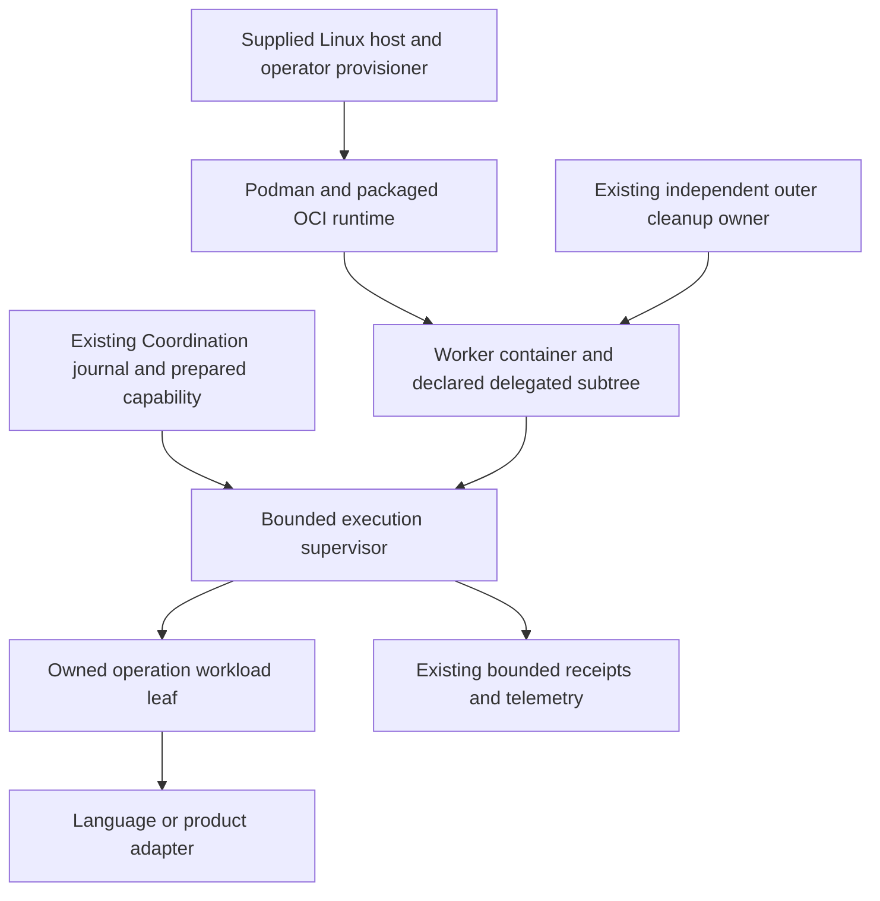

# Provisioned Podman execution for Unified Roadmap v3

Date: 2026-10-13. Status: proposed design; no runtime, compatibility promise, authority or required check changes on document delivery.
Programme: [Unified Roadmap v3](../roadmaps/2026-10-07-unified-development-roadmap-v3.md).
Delivery: [V3-ENV-01 roadmap](../roadmaps/2026-10-13-provisioned-podman-execution.md).
Research: [prior-art assessment](../reports/2026-10-13-provisioned-podman-prior-art.md).

## Decision and expected benefit

Qualify one provisioned Linux/Podman execution profile with fresh, ephemeral host-backed storage as the primary environment for selected FS-GG workloads. The concrete storage objective is to mitigate slow nested builds described in Podman's troubleshooting entry 42 while allowing development from a blank slate on one machine. Reuse the existing Coordination execution contracts, operation journal and bounded observation interfaces. Reuse Podman, its packaged OCI runtime and cgroup-v2 mechanisms instead of building another container manager. Separate the provisioner's platform guarantee from each application's correctness and installed acceptance.

The first storage pilot compares the current nested build route with nested Podman whose writable store resides in a fresh directory on a supported local host filesystem. The operation supervisor remains outside its workload leaves; strong profiles need exclusive delegation and genuine custody qualification. A separately qualified per-operation container topology remains an alternative where the existing authorized provisioner supplies finite launch and cleanup without exposing host command or runtime services to workloads. An ordinary agent container alone does not establish operation isolation.

The largest expected reductions are platform variation in PROC, repeated enforcing-runtime qualification in LANG, and environment feasibility/recovery setup in LEARN. Installation and toolchain consistency also help UTEL/EFF, knowledge and template receivers. No numerical saving follows from containerization alone. Preserve publication, real provider execution, causal correctness, accessibility, GPU and native-engine acceptance as separate work.

The current supplied development container has an observed Arch Linux/Podman package profile, recorded below. Its namespace execution, storage benefit and independent teardown remain unqualified. Sole-platform support has not been selected; the proposal retains existing compatibility promises. Source inventory does not authorize further provisioning or native execution.

## Evidence and current constraints

The protected v3 roadmap was read through GitHub's contents GET at blob `5797d49e9aa2cddb42df95037f3a1c92edfd6ae4`. Its baseline has 17 outcome families, two accepted and 15 open. That count describes formal closure, not remaining effort. Later implementation or publication activity is outside this design's evidence scope.

The [shared process contracts](../roadmaps/2026-10-11-shared-process-contracts.md) already define literal commands, original operation identities, requested/obtained capabilities, monotonic work/cleanup budgets, bounded byte sinks and retained sessions. Coordination owns those semantics. Their accepted source scope is not general descendant containment.

The [process supervision design](../roadmaps/2026-10-05-shared-process-supervision.md) requires exclusive delegated cgroups, pre-execution placement, stable process authority and separate cleanup observation. It forbids introducing a broad host command service or host socket. The new profile must preserve those constraints; provisioning is an operator-owned boundary, not a privilege an agent discovers or installs.

The [language plan](../roadmaps/2026-09-29-language-independent-workspaces-and-agent-integration.md#language-qualification-population) already factors common lifecycle cases by identical enforcing runtime/profile while retaining real TypeScript/Rust/Go, mixed-component and no-.NET product journeys. The [persistent LEARN receiver](../roadmaps/learn-c2-persistent-receiver-v3.md) records missing UID mapping and cgroup delegation, alongside unresolved acquisition/custody and installed-runtime acceptance. Provisioning may resolve the former; it cannot reconstruct the latter.

Repository owner plans and their pinned source links were inspected. Other product repositories were not available in the local workspace, so this assessment does not claim a fresh exhaustive source audit of their current heads. The research report separates directly inspected upstream source, documented capabilities, proposals and unqualified guarantees.

## Supplied development profile: source inventory, 2026-10-13

Read-only inspection after the external rebuild observed Arch Linux image metadata
`VERSION_ID=20260927.0.600689`, kernel `7.2.4-arch1-2`, architecture `x86_64`
and installed package metadata: Podman `6.1.3-1`, crun `1.30.1-1`, conmon `1:2.2.1-1`,
containers-common `1:0.69.2-1`, passt `2026_10_02.cba3570-1` and shadow
`4.20.0.arch1-1`. These are local inventory observations; executable runtime
results, authenticated image identity and portable package archives remain separate.
Podman, crun, conmon and the passt target of the pasta symlink are root-owned mode
`0755`; newuidmap/newgidmap are root-owned mode `4755`.

The current UID/GID maps are `0 1 65536`. The developer's subordinate UID/GID entries
are `1024:64510`, within the parent namespace and excluding developer ID `1000`.
This repairs the earlier visible range mismatch, but no nested namespace probe has
run. Effective capabilities are zero, `Seccomp=0` and `NoNewPrivs=0`; these observed
settings do not establish a selected security profile or authorize policy changes.

The visible cgroup-v2 root is read-only, with `cpu.max=400000 100000`,
`memory.max=8589934592` and `pids.max=2048`. Those shared outer limits supply no
per-operation delegation or containment proof. Ordinary bounded namespace/storage
feasibility can use an existing qualified execution route without waiting for a
new contained backend, provided actual admission, helper accounting, retained
custody and bounded cleanup are valid. The stronger execution envelope still needs
its requested capabilities and independent cleanup evidence.

The developer owns mode-`0700` mounts at `/var/tmp/fdev-podman` (1 GiB tmpfs),
`/home/developer/.local/share/containers` (4 GiB tmpfs) and `/run/user/1000`
(128 MiB tmpfs). A fresh operation-owned child of the first is a candidate for a
small VFS/crun feasibility probe; it is not a qualified allocation. These
memory-backed mounts do not establish the proposed local disk-backed build-storage
mitigation. Allocation identity, effective per-run paths, byte/inode bounds,
authentic provisioner/image inputs and an independent teardown owner remain open.

Existing Coordination toolchain profiles carry source/image/component identities
and runtime/output bounds; its portable runtime policy carries explicit Podman
arguments, state root and host/container environments. Inventory therefore starts
with those contracts. An authentic allocation/launch/teardown caller seam must be
selected before proposing any additive allocation field. The current portable
image qualification scripts have per-command process timeouts but do not establish
the aggregate deadline and helper/descendant cleanup needed to admit this probe.
The previous private selected-entry guard is unavailable; its loss does not add a
new gate to ordinary development. It prevents reusing that guard as native proof.

The [saved source frontier](../handoffs/2026-10-13-095258-unified-roadmap-handoff.md#private-evidence-drafts-and-truthful-limits)
retains the original Arch acquisition failures and partial outcomes. Its private
image drafts and retained acquisition bytes are now missing. Reconstruct source
from authentic inputs under the same owner; do not reconstruct acceptance,
checksum manifests, old packet/attempt joins or consumed grants. A buildable common
base still needs genuine donor state, maintained full-system resolver output,
trusted package archives and the exact SDK archive. All historical unknown
operations and reservations remain unresolved.

## Deployment, distribution and workspace adoption

The shared environment is proposed development and qualification infrastructure for framework repositories and product workspaces. Framework development is the first storage pilot, not a restriction on supported consumers. Product production deployment remains under each product's release owner; adopting this development image does not select a production image or change its runtime architecture.

### Source and release ownership

| Location | Proposed responsibility | Distribution boundary |
|---|---|---|
| `FS-GG/.github` | Shared base Containerfile, common environment specification, framework-development profile, qualification and image release workflow | Publish a versioned, qualified shared base image and its exact profile/source metadata |
| `FS.GG.Coordination` | Launcher/execution implementation, operation identity, budgets, profile validation, allocation/reconciliation and cleanup adapters | Reuse existing tool/package distribution where suitable; no new broad host service or second journal |
| `FS.GG.Templates` / SDD | Reusable language/toolchain profiles and workspace materialization, including fresh creation and deliberate retaining upgrades | Preserve existing owned image/profile source; consume the shared base rather than moving all image definitions into `.github` |
| Framework repositories | Select a published framework profile and retain their own build/test/release entrypoints | Consume the same qualified launch/storage contract; keep repository source independent of the image |
| Product repositories | Select toolchains, component entrypoints and any required small image extension | Pin a published profile or derived image; retain product implementation and delivery authority |
| Supplied host/provisioner | Linux/Podman capability setup, outer-container launch, scoped host allocation and independent teardown ownership | Install the exact qualified launcher/profile through the existing authorized provisioning route |

The shared Containerfile contains the common development environment, not every product's source or all language SDKs. Keep toolchain variants small and owned. A product can use a published profile directly; it needs its own derived Containerfile only for genuinely additional dependencies. A derived image selects an exact base digest, qualifies its added inputs and is published by its owner. Framework or product source changes do not require rebuilding an unrelated shared base.

GHCR is the proposed OCI image registry, subject to the organization's existing publication permissions and coherent release route. It supports image consumption by digest. Record the selected platform manifest alongside any index and source/profile revision; a mutable tag remains a convenience alias. The Containerfile is source, while the published image is the installed artifact. [GitHub Container Registry](https://docs.github.com/en/packages/working-with-a-github-packages-registry/working-with-the-container-registry).

### Host prerequisites and one-time setup

The proposed host is a supplied compatible Linux machine, with a supported architecture and serviced kernel. The exact release is still an input to qualification. The image supplies development toolchains; the host supplies the kernel, container engine, backing filesystem and launch authority. Container image selection does not provision those host capabilities.

| Requirement | Baseline development/storage profile | Additional selected guarantee |
|---|---|---|
| Linux and runtime | Qualified kernel/architecture, Podman and its packaged OCI runtime/conmon dependencies | Actual syscall/namespace capabilities required by the chosen custody backend; a version string alone is insufficient |
| Local backing storage | Supported local filesystem, adequate bytes/inodes, one writable operation-owned allocation outside the worker's image overlay | A hard storage bound requires a proven quota/volume mechanism; a temporary directory alone has none |
| Launch/cleanup owner | Installed qualified launcher or existing provisioner able to create/bind the allocation, observe retirement/unmount and remove its own paths | Independent bounded recovery after caller/worker/provisioner failure; actual host-reboot reconciliation where claimed |
| User identity | A mode/ownership mapping that can access only the declared inputs and allocation | Rootless setups require appropriate subordinate UID/GID ranges and mapping helpers where used; nested maps must be checked independently |
| Kernel resource control | Proposed supported target uses cgroup v2 and the selected effective CPU/memory/task controllers | Strong per-operation containment needs exclusive delegated control, pre-exec placement, workload migration/control denial and observation access |
| Security policy/nesting | Selected namespace, mount and backing-store operations permitted by actual AppArmor/SELinux/seccomp policy | Native-overlay nested builds need proven actual mount/driver support; FUSE alternatives need the selected FUSE device/helper access |
| Acquisition/export | Registry/source/package access during declared acquisition, or preverified offline inputs; declared durable output destination | Publication credentials, receiver grants, device/display/GPU access remain separate selected authorities |

Rootless user mapping is documented by [Podman](https://docs.podman.io/en/latest/markdown/podman.1.html); controller delegation has an explicit [kernel contract](https://docs.kernel.org/admin-guide/cgroup-v2.html#delegation). Operator-owned setup may be needed for missing user ranges, delegation, filesystem labels or allowed namespace/mount policy. Once provisioned, normal development should use the qualified ordinary-user profile where feasible. No privileged default or broad security-policy disable is implied.

A plain Podman container and the host-backed storage benchmark need not wait for a new strong-containment implementation when their existing qualified execution route suffices. A cgroup mount that is merely visible/read-only cannot satisfy a requested delegated operation profile. Successful nesting alone does not prove hard limits, no escape or bounded cleanup.

Host .NET, Node, Rust, Go and framework source checkouts are not development-image prerequisites. Package the launcher as a self-contained executable or an existing provisioner component where suitable; any actual launcher client/runtime dependency must be declared and installed through its owner. A framework implementation language must not silently become a host SDK requirement. No Docker daemon, host Podman API socket, Kubernetes cluster or permanent writable image store is required by this proposed CLI/profile route.

A developer supplies the workspace/source inputs and a supported profile selection. The provisioner owns temporary storage setup and teardown; an explicit bootstrap/install route checks and reports unmet host prerequisites rather than attempting to grant its own privileges. A missing required capability blocks that dependent launch, while independent source work remains available.

### Unattended normal use acceptance gate

After one-time authorized host setup and installation, normal V3 use must have no human
host-agent dependency. The installed provisioner and launcher must automatically allocate
fresh operation-bound storage, bind it before workload release, launch the selected workspace,
and perform scoped teardown and worker-loss recovery through the existing authority and
operation records. A normal run or its failure recovery must not require a person or host agent
to issue per-run host commands, relay evidence, approve allocation or cleanup, or repair state.
The developer still selects declared workspace inputs and invokes the installed entrypoint.

One-time setup may establish prerequisites, trust and the installed qualified profile. Routine
operation thereafter must validate current prerequisites and refuse unavailable capabilities
without requesting a manual host-agent fallback. Recovery retains original identities, deadlines,
export obligations and unresolved cleanup. When safe completion cannot be established, the
installed path must report bounded `Incomplete` or `Unknown` and retain the hold automatically;
unattended operation does not permit unsafe deletion or an invented successful recovery.
Exceptional operator repair cannot count as a successful unattended acceptance case.

Acceptance requires genuine installed observations of fresh allocation/binding, normal completion
and teardown, and worker-loss recovery with the human host-agent channel absent. Include
provisioner restart and supported host-reboot reconciliation in the selected recovery population.
Manual pilots, reviewed source, pure fixtures and source/evidence handoffs are preparation evidence;
they cannot close this gate or V3-ENV-01. This is the user's
[normal-use requirement](https://github.com/FS-GG/.github/issues/4516#issuecomment-6193108499),
not a claim that the installed lifecycle is already available.

### Workspace materialization

Templates/SDD materialize the selected image/profile reference, toolchain versions, component build/test entrypoints and applicable launch/storage requirements into a workspace's existing versioned declaration. If the current schema lacks a necessary field, propose an additive change through its owner; these names are conceptual requirements, not newly implemented schema keys. A generated Dev Container configuration can offer editor integration, but it cannot grant host capabilities or override the provisioned profile.

Ordinary product workspaces consume released tooling and profiles without cloning `.github` or Coordination, using repository-source fallbacks or adding framework implementation dependencies to product code. Any runtime required by shared tooling belongs to its declared distribution prerequisites. A Rust, Go or TypeScript product retains its native build system; mixed products keep distinct component/toolchain checks and a composed journey.

Image/profile updates are explicit retaining upgrades. Keep the prior digest/profile available for rollback, preserve source and declared workspace settings, and qualify the changed materialization and affected lifecycle cases. A new image tag does not silently update an existing workspace. Local-only operation uses previously verified declared inputs and keeps cold versus cached acquisition evidence explicit.

### Launch and teardown sequence

1. The owning CI route builds and qualifies the shared or derived image, then publishes its exact artifact/profile metadata. Workspace declarations pin that released selection.
2. The installed launcher validates the supplied host and the requested workspace profile against current actual capabilities and existing authority. A mismatch refuses the dependent launch.
3. The provisioner allocates a fresh operation-bound host directory or supported ephemeral volume. The launcher binds its declared storage paths into the development container before releasing the workspace entrypoint.
4. The container receives declared source inputs and isolated engine, scratch, cache and development-home paths. Ordinary commands run directly inside it; nested Podman is selected where container builds or another actual consumer require it.
5. The existing owner exports selected source changes, artifacts and bounded evidence, retires owned workloads/helpers, observes mount release and removes only the original ephemeral allocation.

The Containerfile cannot allocate a host directory, mount it into its own parent or authorize outer-container permissions. Those are launch/provisioner responsibilities. Per-workspace configuration can request a supported profile; actual capability and filesystem authority remain with the provisioner and existing prepared-operation boundary. [Podman runtime configuration](https://docs.podman.io/en/latest/markdown/podman-run.1.html).

On one machine, a fresh allocation from a stock, digest-verified guest image under fdev nested KVM installs the qualified launcher/profile, acquires the pinned image and reconstructs source plus explicitly supplied changes, with no state carried over from earlier runs. Cross-machine independence is not claimed (owner ruling, #4821); a required host reboot happens only on owner request and is otherwise reported pending. Do not transfer writable engine stores, incidental home/configuration or dependency caches. Source and durable acceptance history remain persistent with their owners. Selected caches are an explicit opt-in mode and never substitute for the default blank-slate journey.

## Supported scope and exclusions

The first profile covers selected command execution and receiver qualification on one supplied Linux host class and architecture. Workloads include ordinary .NET/F#/Python tools, declared TypeScript/Rust/Go fixtures, telemetry receivers and an inactive LEARN image. Pin each language's toolchain separately; a common kernel does not make their entrypoints identical.

Public consumer libraries can retain portable contracts while the strongest execution guarantee is scoped to this profile. Existing promises on other environments remain until their owners explicitly change supported scope. Defer new backend development when no selected consumer requires it, rather than removing existing acceptance silently.

GPU/browser presentation, assistive technology, Unity Editor/Server and native game authority are separate profile extensions. They require explicit device, display/session, driver, engine and access facts. No GPU result is inferred from a headless browser or CPU-only pass. No container profile grants product command authority.

This design does not reopen completed Board or Box2D/Portal P3 outcomes, restart stopped SVG profiling, replace Akka, introduce Kubernetes, mandate new fleet infrastructure or activate LEARN. Containers share host-kernel dependencies; this profile is not a VM-equivalent isolation claim for arbitrary hostile tenants.

## Profile and readiness contract

Record the following inputs in the existing preparation/evidence path. `V3-ENV-01` is a roadmap identifier, not a new authority registry or service. A future serialized representation belongs in the existing contracts only after the inventory demonstrates a missing field.

| Layer | Exact inputs | Revalidation or invalidation |
|---|---|---|
| Host | Distribution/release, kernel build and relevant configuration, architecture, boot identity, systemd version if used, security-policy revisions | Kernel/boot/security changes invalidate affected capability evidence |
| Engine | Podman, OCI runtime, conmon and init package versions/content identities; cgroup manager; storage/network backend | Runtime or effective configuration changes invalidate lifecycle reuse |
| Image | Registry reference, OCI index and selected platform-manifest digest, image configuration/layers, toolchain identities, entrypoint | Mutable tags do not supply an immutable workload identity |
| Identity | Rootless/rootful mode, host owner, UID/GID mappings, subordinate ranges, runtime/procfs visibility | Revalidate actual maps in the selected namespace; image UID alone is insufficient |
| Containment | Namespace layout, owned subtree handle/identity, delegation, enabled controllers, effective ancestor limits, control-write/migration denial | Revalidate before launch and retain observed facts; refusal has no weaker fallback |
| Resources | CPU quota/period and optional affinity; memory/swap; kernel tasks; semantic process/CLR budgets; scratch/output allowances | Values are selected role inputs, never new programme-wide defaults |
| Filesystem | Read-only inputs, exact writable work/scratch/artifact paths, cache policy, mount/label options, retention | Added writable mounts or shared caches create a different affected profile |
| Network/access | Declared acquisition versus execution mode, permitted endpoints/credentials, device access | Changes invalidate affected authority and confidentiality assumptions |
| Lifecycle | Supervisor/reaper identity, outer cleanup owner, caller-loss action, original work deadline and cleanup reserve, recovery rule | A new boot/session cannot reinterpret an old monotonic deadline |
| Evidence | Producer source/artifact, profile digest, operation/attempt/generation, requested and observed facts, bounded private/public projections | Partial or stale observations cannot earn whole-profile acceptance |

Provisioner statements are authenticated through the existing trust path. Container-visible inspection is supplementary and cannot authenticate host configuration by itself. Readiness distinguishes `Supported`, `Unavailable`, `Unknown` and `Mismatch`; only the selected capability's proven status admits its effect. Collect independent readiness defects in one bounded preparation pass, following [diagnostic execution](../roadmaps/diagnostic-execution.md), without launching work dependent on a failed prerequisite.

Pin a serviced host/profile generation, not an indefinitely frozen vulnerable kernel. An update produces a successor profile and affected-case qualification. In-flight operations retain original identities and deadlines; they are not silently migrated to renewed authority.

## Architecture and ownership

The diagram shows authority boundaries, not another daemon. The host provisioner owns host configuration and the outer container; Coordination owns execution and reconciliation; product adapters own command semantics. The supervisor cannot modify the host or another manager's hierarchy. Follow systemd's [single-writer delegation model](https://systemd.io/CGROUP_DELEGATION/).

Keep the supervisor outside the leaf it may exhaust or terminate. Charge it, Podman/runtime helpers and any services to the correct existing outer allowance. A supervisor outside a workload leaf is not outside the programme budget. If control-plane and workload CPU compete inside one parent, reserve enough existing capacity for retirement and observation; report infeasibility rather than raising limits.

### Compare the launch topologies

| Topology | Benefit | Remaining obligation | Disposition |
|---|---|---|---|
| Long-lived worker container with plain child processes | Fixed toolchain and bounded outer resource envelope | Per-operation descendants, shared writable state, caller loss and cleanup remain | Suitable for explicitly weaker ordinary scope; not strong containment |
| Worker container with delegated per-operation leaves | Fits existing custody design; low repeated image startup; one narrow native boundary | Actual delegation, workload control denial, placement before exec, independent supervisor/outer owner | Proposed first feasibility pilot |
| Per-operation Podman/OCI container, launched by the existing provisioner | Natural operation namespace/filesystem boundary; simpler whole-container retirement | Provisioner launch contract, helper accounting, original identity, retained cleanup and startup overhead | Evaluate as an alternative; no host socket or broad service admission |
| Nested Podman with an ephemeral host-backed store | Preserves a container-local CLI route and targets the reported nested-build I/O problem | Actual native-overlay selection, mappings, mounts/storage, nested delegation/security policies and helpers | First storage feasibility pilot; enforcement is qualified separately |
| Host API socket exposed to workers | Convenient tool/library integration | Grants broad runtime authority beyond this contract | Excluded from the first profile |

Podman's API documentation states that its service permits full Podman functionality as the service user. A Docker-compatible socket therefore does not provide a narrow execution capability. [Podman service](https://docs.podman.io/en/latest/markdown/podman-system-service.1.html).

A supplied operator may manage the outer worker with declarative Quadlet units. Treat this as provisioning/lifecycle configuration, not authority for an agent to call systemd or arbitrary Podman operations. Quadlet requires cgroup v2; cold image acquisition and service startup need explicit bounded treatment. [Quadlet](https://docs.podman.io/en/latest/markdown/podman-systemd.unit.5.html).

### Launch and recovery

Use the existing `Prepared -> Starting -> Running -> Retiring -> Terminal` lifecycle. Persist original launch intent before an effect. Bind the operation to its profile, image, exact command and generation. A display name or attacker-writable label is not launch authority.

Establish the workload leaf and limits before releasing executable code. Prefer the packaged OCI runtime's qualified creation path for a whole-container operation. For delegated subprocess operations, qualify the existing reviewed pre-exec launcher or supported `clone3` placement, rather than spawning a process and then migrating it. [Linux clone semantics](https://man7.org/linux/man-pages/man2/clone.2.html).

Ambiguous launch is reconciled against the original operation and runtime identity before retry. Reconnecting, a service restart, health-check recovery or a scheduler retry cannot launch a second operation under a renewed budget. Default automatic restart is disabled for finite effectful operations; any selected long-lived receiver restart has its own existing recovery contract.

Use stable process handles where individual signaling/exit observation is needed. A pidfd refers to an acquired task; obtaining it still needs the qualified generation/acquisition path. Procfs and container inspection supply observations, not independent ownership. [pidfd API](https://man7.org/linux/man-pages/man2/pidfd_open.2.html).

Keep work and cleanup under one original monotonic total bound. Preparation/acquisition can be a distinct previously declared operation, but cannot be hidden outside accounting. Cold pulls/builds are excluded from a warm execution claim only when their separate time and costs are reported. An engine timeout supplements the owner contract; it does not prove bounded API return, final observation or filesystem cleanup.

After host reboot, an old monotonic clock value is unusable in the new clock domain. Reconcile original effects through existing durable identity and bounded recovery, recording uncertainty if authority or observation is missing. Do not revive an expired lease from a wall-clock conversion.

## Resource enforcement and accounting

| Quantity | Proposed mechanism | What it does not establish |
|---|---|---|
| CPU capacity | Effective cgroup quota and optional cpuset; aggregate usage and throttling observations | Quota is neither affinity nor exclusive CPU access; no hard real-time guarantee |
| Memory | Effective aggregate memory/swap controls and events; workload plus designated helpers | Sampled RSS is not an aggregate bound; tmpfs and caches consume resources too |
| Kernel tasks | Effective `pids.max` and its events | Kernel tasks include threads; this is not a semantic process or CLR count |
| Semantic processes/CLR | Existing admitted launch restriction/reservation, or explicitly sampled inventory | Generic Podman limits cannot establish an exact hard CLR-process cap |
| Output | Combined raw-byte charging before retention, across streams, protocol and evidence | Runtime log rotation is not a bound on bytes produced or downstream processing |
| Scratch/storage | Selected writable paths and a supported bound/quota; observed usage and ENOSPC outcomes | Containers/cgroups do not automatically impose a per-operation disk-space quota |
| Network/API usage | Declared access and bounded requests through existing adapters | Container CPU/memory figures cannot establish token cost or causal wait attribution |

Use effective ancestor limits and controller presence, rather than requested flags alone. The [kernel cgroup contract](https://docs.kernel.org/admin-guide/cgroup-v2.html) defines controller semantics; permissions and policy must also allow the selected operations. A fixed kernel number is insufficient without a capability check.

No existing cap is changed by this proposal. The shared-process plan's selected examples and LEARN's narrower role bounds remain distinct. A profile that cannot run its supervisor/toolchain inside those bounds reports a failed feasibility result.

Charge runtime/helper overhead once at the appropriate level. If a shared database or registry cache serves several operations, retain a shared-cost bucket until a justified allocation exists. Never sum parent usage and all child usage as independent cost, or turn queue overlap into critical-path delay.

## Output, logs and telemetry

Read stdout/stderr concurrently as bytes through the qualified sink. Bound protocol frames and incomplete lines; charge bytes before appending prefix/tail or files. Retain first cause, independent failures and cleanup status. Redaction precedes public diagnostics. No full environment, inspect payload or credential is emitted by default.

Podman/conmon logs and events are useful independent evidence. They are not the canonical operation journal. Event logging can be disabled and retrieval has retention/order limits, so missing events remain incomplete evidence. [Podman events](https://docs.podman.io/en/latest/markdown/podman-events.1.html), [logs](https://docs.podman.io/en/latest/markdown/podman-logs.1.html).

The [conmon source](https://github.com/containers/conmon/blob/3f89b60f87e72c22d0ca3eae8cca942f0b509b85/README.md) explicitly supports container monitoring after the launching manager exits. Qualify that detached lifetime and helper accounting; observing a CLI exit cannot establish container termination.

Reuse UTEL's existing envelope, schema and causal declarations. Bind available container/profile/resource identities through existing extensibility only where supported; propose an additive coherent schema change if necessary. Receiver compatibility and correction/replay proofs remain mandatory for any actual schema change. This design does not preselect one.

## Cleanup and settlement

Graceful retirement, forceful retirement, observed workload emptiness, child reaping, output settlement and owned resource removal are separate facts. A stop command, successful exit code, OCI `stopped` state or deletion request is not the full conjunction.

For delegated leaves, use the accepted original scope and qualified stable handles. Request recursive termination where required, then observe the subtree and owned process generations within the original reserve. Child reaping has its own designated owner and evidence. The kernel excludes zombies from live populated state; empty live membership cannot replace reaping proof.

For whole-container operations, observe the exact runtime identity, payload emptiness and qualified runtime/helper retirement. Distinguish workload, conmon/init and provisioner obligations. Runtime metadata disappearance is not automatically proof that all original tasks or owned volumes are absent. Preserve the evidence needed before metadata is deliberately removed.

A caller crash is handled by the existing independent owner. A supervisor crash must not orphan an untracked workload. Loss of read authority, stuck kernel tasks, pending pipe readers, a failed reap or expiry returns `Incomplete` or `Unknown`; the original owner retains unresolved obligations. There is no untracked background cleanup task that permits a successful settlement.

Retained historical escaped operations remain historical unknowns. A successful new container pilot may prevent the same failure in its scope, but cannot certify cleanup of an earlier unrelated operation.

## Ephemeral host storage and nested-build performance

### Concrete failure hypothesis

Podman's [troubleshooting entry 42](https://github.com/podman-container-tools/podman/blob/b17e7db1d3ad0c6ca56e292aa95273facb80f8ad/troubleshooting.md#42-podman-in-podman-builds-that-are-file-i0-intensive-are-very-slow) describes slow nested `COPY`/`ADD` and I/O-heavy build steps associated with fuse-overlayfs, and proposes a host-backed store enabling native overlay. It also offers VFS when the parent launch cannot be changed. This is a concrete mitigation hypothesis, not a universal driver ranking or proof that FS-GG has the same bottleneck.

The documented example uses a privileged parent. This design does not adopt that launch recipe. Qualify the least-privileged supplied nesting profile and record any required operator-owned capability. A performance improvement obtained only by changing enforcement is a separate profile result, not an equivalent replacement.

The host-backed directory must actually reside on a supported local filesystem. Binding another overlay-backed or network-backed directory can preserve the problematic storage path. Record mount identity, filesystem/type/options, native versus FUSE implementation, effective `mount_program`, graphroot/runroot and inner/outer engine versions. `overlay` as a driver name alone does not distinguish native overlay from fuse-overlayfs.

### Proposed layout and ownership

Each run receives a provisioner-created directory with a unique operation-bound identity, mounted only into its worker. Conceptual children are `engine-graph`, `engine-run`, `build-tmp`, `workspace`, `tool-caches` and `export-staging`; these are layout names, not an executable configuration. The identity and mount handles belong to the existing owner. Workloads cannot choose arbitrary host source paths or redirect deletion.

The inner engine's graphroot, runroot and any separate image store point to this run's declared storage. Build temporary files and package/tool caches also use its isolated paths. Do not repurpose the developer's real HOME or global Podman configuration. Supply a dedicated container-local development home and explicit per-run configuration through supported engine/tool inputs. Read back effective paths rather than relying on environment variables alone.

Do not put a populated inner-engine store in the worker image and then hide it with the new mount. Seed immutable input images through a declared acquisition/load phase if useful; never inherit a previous run's writable engine metadata. Inspect named/anonymous volumes, build caches and temporary extraction paths, not just graphroot.

The [containers/storage configuration](https://github.com/containers/storage/blob/main/docs/containers-storage.conf.5.md) separates graphroot and runroot. Its transient-store mode concerns metadata and does not establish cleanup of all layers, volumes or build outputs. Prefer explicit owned-directory lifetime; transient-store is an optional later measured setting, not the meaning of ephemeral storage.

### Driver and backing-store alternatives

| Candidate | Intended advantage | Tradeoff and qualification |
|---|---|---|
| Native overlay on a fresh local host-backed directory | Avoid the reported nested FUSE path; copy-on-write layers rather than full duplication | Kernel, backing filesystem, mappings, mount and security policy must support the real nesting profile |
| fuse-overlayfs on the same fresh host-backed directory | Rootless compatibility where native overlay is unavailable | Userspace/filesystem overhead remains; compare actual metadata-heavy operations before selecting |
| VFS in a fresh isolated store | Compatibility alternative; no overlay mount dependency in the inner storage driver | Layer copying may increase disk bytes, space and startup work; qualify against the actual workload |
| Quota-controlled ephemeral local volume | Disk-backed capacity with independent run lifetime | Requires actual filesystem/quota support and provisioner allocation/cleanup; a directory alone has no quota |
| Size-bounded tmpfs | Disposable memory-backed scratch for a small selected hot set | Consumes memory/swap budget and can cause OOM; backing/overlay support is profile dependent; not a default whole image store |
| Fresh writable store plus a shared read-only immutable image store | May reduce repeated image acquisition while keeping writable state separate | Optional later cache mode; exact supported driver compatibility and immutable provenance must be proven |

Native-overlay feasibility is a gate to that candidate, not to ordinary source work. No in-place driver switch or global engine reset is proposed. Every driver trial starts from a newly allocated store; the previous store and operation are retired under their original identities.

### Meaning of blank slate

Default cold mode has no prior writable image layers, engine metadata, dependency caches, compiler intermediates, user configuration, build volumes or test/database state. Initialize the workspace from the declared source revision plus explicitly supplied current changes, with source identity recorded. Never reset or delete the developer's source checkout to achieve freshness.

Immutable input images and source bundles are permitted as declared inputs; their acquisition/verification cost and cache state are explicit. A freshly allocated logical store does not clear the host's page cache, CPU caches, registry caches or unrelated workload interference. Claims about physical-cache coldness need separate controlled evidence; no global cache drop is part of this design.

Moving to another machine reconstructs the same declared inputs and profile-compatible environment, rather than transferring a home directory or writable store. Platform-specific manifests and native toolchains remain explicit. A performance comparison across different hardware is not paired evidence merely because the containers match.

Opt-in cache mode may reuse only a declared, bounded, verified input population. Record it separately from blank-slate acceptance; a cached run cannot satisfy cold qualification. Source edits and selected final artifacts are exported deliberately. Raw engine storage and incidental credentials are never the transfer format.

### Lifetime, export and crash recovery

The existing outer owner allocates and binds the directory before launch, retains its identity while active, and independently owns teardown after caller/worker failure. Retirement order is inner workloads and build helpers, settled output/evidence, mount release, then deletion of only the owned ephemeral storage. Do not delete backing files under live overlay/FUSE mounts or report success from a recursive delete request alone.

Cleanup observes remaining mounts, open/living owned helpers and removal through the original scoped authority. Refuse a substituted path, symlink escape or foreign membership. No global prune/reset or deletion of another developer's store is permitted. A failed removal stays an original unresolved obligation; no successor run silently reuses it.

On host restart, the provisioner reconciles its existing owned allocation records before bounded garbage collection. Reboot alone does not erase a disk-backed directory. Unknown original operations are not deleted by age/name alone. Disconnection and expiry do not erase private evidence required for settlement.

Export source patches, selected artifacts and bounded evidence to their declared destination before final removal, with observed export completion. Preserve existing durable operation/acceptance records outside disposable workspace state through their current owner. Machine-local development state is ephemeral; programme history is not. Ephemerality is a logical lifetime guarantee, not a secure-erasure claim for disk media.

### Bounded benchmark and selection

Use one realistic existing build as the primary workload: source-tree/image-context copy plus restore/compile/test/pack where that reflects the selected consumer. Retain a small many-file metadata case and a large-file copy case to discriminate symptoms. Microbenchmarks explain a result; they do not replace the product build. Freeze source, image/toolchain, limits, filesystem and exact nested entrypoint for matched cases.

Compare the current route, native-overlay host-backed candidate, same-store FUSE candidate and VFS only when each can run within the same selected permissions and resource envelope. Record unsupported configurations as unavailable rather than quietly granting privilege. Each cold sample uses a new owned writable store. Randomize/interleave trial order and retain failures/timeouts; distinguish declared input acquisition from execution and total time. State host page-cache/interference limitations.

Measure phase elapsed time, aggregate CPU/throttling, memory peak where available, storage bytes/inodes and growth, host/operation I/O observations with explicit attribution limits, copy/restore/compile outcomes and total cleanup time. Use existing resource machinery first; a separately admitted BenchExec harness is optional if it demonstrably improves observation. No GPU run or stopped SVG profiling is needed for this storage decision.

Predeclare a small finite repeat count and budget with the owner. Choose the candidate only if the real nested workload completes correctly inside existing limits, cleanup and blank-slate recovery pass, and the observed performance/storage tradeoff is useful. Set the benefit criterion before inspecting results; do not invent a target speedup or statistical percentile. If results are inconclusive, retain the current qualified route and report the limitation. Native-container enforcement qualification remains a separate milestone from storage benefit.

## Filesystem, access and artifact integrity

Use immutable inputs and declared work/scratch/artifact paths. Retaining workspace upgrades and writable caches remain distinct from disposable execution. Separate acquisition credentials from ordinary offline execution when feasible; language/toolchain needs determine permitted network access. Private receiver grants and publication credentials do not become generally available inside the base image.

Bind mounts can expose host state beyond an image. Read-only root filesystems do not make separately writable mounts read-only. Validate the selected paths and symlink/mount transitions through the existing held-directory contract; `openat2` resolution constraints are a candidate mechanism, not a guarantee from a path string. [openat2](https://man7.org/linux/man-pages/man2/openat2.2.html).

Select rootless execution when it meets the required actual mappings and delegation. Rootful profiles, nested namespaces, devices and changes to AppArmor/SELinux are separate operator decisions. Avoid blanket privilege or globally disabling security policy as a compatibility fix. Ubuntu documents explicit AppArmor restrictions on unprivileged user namespaces; inspect the supplied distribution's actual policy instead of assuming upstream-kernel defaults. [Ubuntu AppArmor](https://documentation.ubuntu.com/security/security-features/privilege-restriction/apparmor/).

Pin both an OCI index and the selected platform manifest when applicable. Keep image, source, toolchain and package identity distinct. Use the existing publication/provenance trust path; Sigstore verification and SLSA provenance are reusable options if a real acquisition gap requires them. A digest fixes bytes, a signature authenticates its selected signer, and neither proves runtime correctness. [Cosign verification](https://docs.sigstore.dev/cosign/verifying/verify/), [SLSA provenance](https://slsa.dev/spec/v1.2/provenance).

Cold image construction/loading remains a genuine qualification activity. Timestamp normalization and pinned inputs can help reproducibility, but independent builds must compare actual relevant outputs and report differences. A warm cached run or version-only executable call cannot substitute for cold installed acceptance. [Podman build controls](https://docs.podman.io/en/latest/markdown/podman-build.1.html).

## Prior-art reuse decisions

The [research report](../reports/2026-10-13-provisioned-podman-prior-art.md) records inspected source and the detailed comparison. These are proposed dispositions, not adopted dependencies.

| Layer | First candidate | Selection rule |
|---|---|---|
| Container lifecycle | Distribution-supported Podman, conmon and one packaged crun or runc | Qualify the supplied set; do not replace its runtime on an upstream microbenchmark |
| Provisioning | Existing operator machinery; Quadlet when already appropriate | Declarative reproducibility without exposing host control to workloads |
| Operation semantics | Existing Coordination contracts/journal/supervisor | Preserve authority, recovery and typed observations; no second orchestrator |
| Cgroup adapter | Existing qualified native boundary; assess Meziantou public API for ordinary management | Adapt only where launch ordering, handle-scoped control and bounded observation are demonstrably satisfied |
| Benchmark methodology | BenchExec `runexec` and cgroup/isolation patterns | Candidate for a disposable comparative harness; not automatic production supervisor replacement |
| Additional inner sandbox | nsjail; isolate or bubblewrap as alternatives | Select only if OCI/delegated profile leaves a demonstrated policy gap; avoid stacking redundant managers |
| Reaping | Existing qualified init/reaper; evaluate packaged Tini/dumb-init if missing | Signal forwarding/reaping is complementary to containment and final observation |
| Test services | Existing fixture route; Testcontainers where its authorized API/cleanup model fits | No host socket introduced solely to obtain a convenient test library |
| Developer images | Dev Container metadata/OCI descriptors | Reuse toolchain declarations; developer configuration is not an enforcement authority |
| Stronger hostile isolation | gVisor or a microVM only for a selected threat requirement | Separate compatibility/hardware/performance evaluation; not first-profile scope |

Keep the bounded PROC .1 decision intact. CliWrap, ProcessKit and Meziantou source inspection does not retroactively qualify replacing existing runners. Verify exact versions, dependencies and distribution licenses in the later chosen window. Prefer a public-API adapter or a small upstream contribution over maintaining a fork; record a concrete semantic gap before custom code.

## Acceptance and adversarial cases

The following proposed matrix is grouped for reuse. Actual case selection, budgets and allowed fault injection belong to each admitted disposable pilot. Pure fixtures establish source behavior; real negative cases establish only their selected native scope. Existing required checks remain unchanged until an explicitly reviewed implementation change.

| Group | Required proposed cases | Evidence boundary |
|---|---|---|
| Profile identity | Wrong kernel/runtime/image/platform/profile, changed boot, stale readiness, mismatched UID maps, disabled controller | Refuse before dependent effects; retain independent defects |
| Nested storage | Native versus FUSE selection, unsupported backing filesystem, populated image store, stale driver metadata, nested mapping/delegation denial | Actual effective storage/configuration identity; no privilege or global reset fallback |
| Blank slate | Fresh allocation on one machine with no carried state, poisoned previous cache, undeclared named volume, leaked config/credential, retained build intermediate | No previous writable state influences the fresh run; declared input/cache mode remains explicit |
| Ephemeral teardown | Caller/worker/host loss, export failure, live FUSE mount, ENOSPC, substituted cleanup path, foreign run store | Original outer owner observes scoped cleanup or retains Incomplete/Unknown |
| Authority | Foreign subtree, replaced path, forged operation label, attempted control writes/migration, unauthorized host socket/device | Observe refusal in the selected disposable scope; never probe unrelated production resources |
| Placement | Immediate child/thread fork at launch, nested child, `setsid`, orphan/reparent, supervisor OOM pressure | Demonstrate creation inside the original restricted scope before workload release |
| Deadline | Cancel before launch, during launch/work/drain, held pipe after leader exit, blocked sink, forceful-stop delay | One original work-plus-cleanup bound; honest incomplete results |
| Output | Dual-stream flood, binary data, partial/unbounded line, protocol-frame overflow, failing retention/reporting sink | Combined charging and first-cause retention; no hidden log path |
| Resources | Task/thread exhaustion, memory/OOM, swap policy, quota/throttling, scratch exhaustion | Requested versus effective controls and actual disposition; semantic counts remain distinct |
| Caller/owner failure | Lost channel, caller crash, supervisor crash, conmon/runtime failure, ambiguous launch response | Independent cleanup/reconciliation using the same operation; no duplicate retry |
| Recovery | Receiver/container restart, interrupted durable intent, duplicate receipt, host reboot, expired evidence | Exact original-effect recovery; no renewed deadline or reconstructed historical fact |
| Completion | Exit0 with inherited writer, zombie children, payload empty with live helper, removal failure, unreadable scope | Separate exit/EOF/empty/reap/resource facts; no false Complete |
| Unattended installed lifecycle | Fresh allocate/bind/launch/teardown, worker loss, provisioner restart and supported reboot with no human host-agent channel | Installed provisioner/launcher completes safely or retains bounded Incomplete/Unknown; manual intervention cannot satisfy this gate |
| Installed matrix | .NET/F#/Python and selected TypeScript/Rust/Go; mixed/no-.NET; missing tools and real serialization | Common profile proof plus each actual toolchain/entrypoint and distinct failure path |
| Publication/adoption | Public image/package acquisition, cold install, two cold LEARN images where required, retaining upgrade, rollback | Published bytes and genuine receiver evidence; no repository-source fallback |
| Telemetry | Receiver ingest/reopen/replay/conflict, resource samples missing, event loss, correction and duplicate delivery | Explicit provenance/coverage; no inferred causal wait, token cost or savings |

## Impact on the remaining v3 outcomes

| Existing family | Work reduced or shared | Work retained under its owner |
|---|---|---|
| UTEL | Installation/runtime setup; exact profile attribution | Original-effect reconciliation, publication, installed collection and historical unknowns |
| Routine coverage | Predictable observation/collection environment | Settled attempt populations, actual usage and coverage policy |
| EFF | Provider/store/dashboard environment; compatible receiver cohort | Canonical correction, provider execution, calibration and live pilot |
| PROC | One selected Linux enforcement backend; reusable capability cases | I/O/deadline correctness, actual containment, selected consumer replacement/publication |
| CTX | Stable driver/restart environment | Authentic owner/watcher/restart integration, ordinary evaluation and retirement; conditional economics separate |
| Knowledge | Wizard/toolchain/image setup | Published composition, fresh creation, preserving extraction and 10 MiB limit |
| SVG Release-D | Shared Wizard/reference cohort | Full installed workspace and selected activation |
| SVG coherence | Reproducible software fixture environment | Update/performance acceptance, real GPU batch and product joins; stopped profiling stays stopped |
| FABLE/template | Shared browser/toolchains/examples setup | Semantic composition, accessibility, lifecycle, clean/retained creation and publication |
| WASM | Guest SDK/toolchain profiles | Adapter-specific ABI/schema/authority and installed joins; no instruction-fuel inference |
| LEARN | Runtime/mapping/delegation feasibility; inactive cold-image setup | Authentic trust/grants/turn/capture/recovery, causal receiver, census and supported comparison |
| LANG | Common enforcing-profile lifecycle cases | Governance/SDD integration and every selected language/mixed/no-.NET installed journey |
| OPS typed | Repeatable execution profile | Production entrypoint adoption and administrative migration |
| FBX | Second-runtime setup | Public installed composition and selected upstream adoption |
| Unity | Repeatable managed/server dependencies where applicable | Genuine engine/title access, native operation, publication and installed product acceptance |

The new environment outcome covers provisioned profile delivery and its conformance envelope. Consumer integration is charged once to its existing owner. A shared install may prove several distinct assertions, but its setup effort is counted once. Completed outcomes and separate games scope are unchanged.

## Economics, measurement and completion

Treat benefit as a hypothesis to test against the existing baseline. Record comparable selected workload/profile/input populations before implementation. Measure environment diagnosis/rework, qualification case reuse, setup and cold/warm elapsed time, supervisor/helper CPU/memory/tasks, bytes retained, cleanup outcomes and installed adoption. Retain attributed owner effort only where actually recorded.

Separate eliminated platform implementation, reused common tests, deferred optional work, execution overhead and external waiting. Container startup can cost more than a direct subprocess; delegated leaves may reduce that overhead. Images can grow storage/network demand. No upstream crun speedup or BenchExec claim is a local savings estimate.

Use optimistic/likely/adverse scenarios after the first actual feasibility pilot: qualified supplied profile; profile needing a bounded provisioning repair; or unavailable delegation/access requiring a different admitted topology. Assign effort ranges only to a concrete selected work breakdown. Host provisioning has an unknown start date until a supplier is named and the actual profile exists; whole-programme finish remains unknown.

Closure requires the finite selected profile to be genuinely provisioned, qualified, delivered through the existing release path, exercised by its declared installed pilots and given an explicit benefit/limitations disposition. Source or document delivery alone supplies none of those runtime outcomes.

## Decisions needed before native implementation

1. Supplied host distribution, exact kernel/service revision, architecture and ownership.
2. Primary versus sole supported execution profile; preserve unwithdrawn consumer promises.
3. Actual rootless mappings, delegation and outer cleanup owner available inside existing limits.
4. First topology and finite consumer population: one PROC disposable pilot, one selected LANG journey and inactive LEARN preparation, without admitting LEARN activation.
5. Registry/publication trust, device/network access and successor/rollback ownership.

These are planning inputs. They do not block independent source work, routine adoption or already qualified programme lanes.
