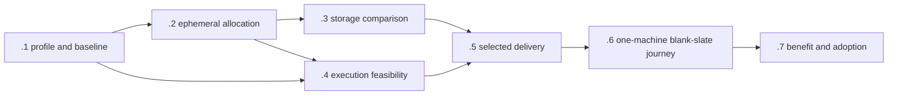

# V3-ENV-01: Provisioned Podman execution and ephemeral nested storage

Date: 2026-10-13. Status: ordinary basic qualification accepted; provisioned storage, strong containment, delivery and portability remain pending.
Parent: [Unified Roadmap v3](2026-10-07-unified-development-roadmap-v3.md).
Design: [provisioned execution](../designs/2026-10-13-provisioned-podman-execution.md).
Assessment: [upstream prior art](../reports/2026-10-13-provisioned-podman-prior-art.md).

Deliver one finite supplied Linux/Podman profile with ephemeral host-backed storage that mitigates the reported nested-build I/O problem and supports fresh blank-slate development on one machine, reconstructed from declared inputs with no carried state. Preserve existing Coordination authority, budgets and cleanup semantics. Qualify the actual storage driver and measured tradeoffs before adoption; do not infer speed or containment from a bind mount.

The new outcome owns host/profile provisioning, ephemeral allocation/teardown and the common conformance envelope. PROC, LANG, LEARN and other existing families own their application integration, publication and installed acceptance. Count shared setup once and link reused exact evidence. The baseline v3 population has 17 rows/two Done; adding V3-ENV-01 makes 18 rows/two Done until actual acceptance changes. This is a scope increase, not negative progress or another estimate of engineering completion.

## Scope and ownership

| Owner | Owned result | Boundary |
|---|---|---|
| Home/SystemAdmin supplied host/provisioner owner | Actual host/kernel/engine/security profile; dedicated ephemeral allocation; independent outer cleanup | Agents cannot provision privileges, expose host sockets or edit host policy through this plan |
| Coordination execution owner | Thin profile/storage adapter and bounded receipts using existing contracts/journal | Existing operation identity, deadlines, role caps and incomplete/unknown semantics remain authoritative |
| `.github` programme/qualification owner | Shared base Containerfile and image/profile release workflow; framework pilot, cross-family scope mapping, benchmark disposition and v3 integration | Publish the common base through the existing authorized OCI route; no second registry, scheduler, board programme or statistical savings claim |
| SDD/Templates and selected receiver owners | Reusable language profiles, exact image/profile materialization, clean installation and retaining upgrade journeys | Keep existing profile ownership; product code/build systems remain independent of framework implementation |
| Framework and product repository owners | Select released profiles, retain component entrypoints and qualify any small derived image | Own additional dependencies, source changes and production deployment; no silent base/profile upgrade |
| PROC/LANG/LEARN owners | Adopt proven common mechanisms in their selected windows | Source/preparation does not authorize native turns or replace historical evidence |

This plan does not resume existing native operations, activate LEARN or admit a publication. It does not remove unwithdrawn cross-platform promises. Ordinary source work, routine process adoption and independent roadmap outcomes continue under their existing qualified routes.

## Unattended normal use acceptance gate — 2026-10-15

After one-time authorized setup and installation, the installed provisioner and launcher must
handle allocation, binding, launch, scoped teardown and worker-loss recovery automatically,
with no human host-agent dependency during normal V3 use. A developer supplies declared inputs
and invokes the installed entrypoint; per-run host commands, approvals, evidence relays or manual
state repair cannot be prerequisites. See the [owning design gate](../designs/2026-10-13-provisioned-podman-execution.md#unattended-normal-use-acceptance-gate)
and the [user requirement](https://github.com/FS-GG/.github/issues/4516#issuecomment-6193108499).

Close this gate only with installed observations covering normal completion and worker loss while
the human host-agent channel is absent, plus selected provisioner-restart and supported host-reboot
reconciliation. Preserve original identities, deadlines, export obligations and cleanup holds;
automatic bounded `Incomplete` or `Unknown` is required when safe completion is unproven and
cannot be reported as successful cleanup. Exceptional operator repair does not pass an unattended
case. Manual pilots, source-only delivery, fixtures and source/evidence handoffs cannot close this
gate or V3-ENV-01. Installed unattended lifecycle acceptance remains pending.

## Current qualification frontier, 2026-10-13

Root accepted the ordinary supplied-profile Podman assertion on 2026-10-13. Clean Coordination source `b11fb121f046898e655b779dfc6809f35fc7aac6` passed native rootless Linux/amd64 preflight with mappings covering container UID 32768. The pinned inputs produced an image whose seven offline Python, TypeScript and composed cases returned exit 0 and matched all six expected output digests. Its OCI export and maintained layer, config, platform and user validation passed within the original operation deadline. See [qualification and limits](../reports/2026-10-13-basic-portable-podman-qualification.md).

The original build failed because Buildah mounted a context overlay on inherited-overlay backing. A fresh admitted context and temporary directory on the existing tmpfs supported the build. The original monitored allocation cap stopped that successor after its seven cases passed; the separately admitted export reused the built image and actual case evidence without replaying either. Both failures remain recorded. This ordinary check required neither systemd nor writable delegated cgroups.

Final scoped readback found no containers, including external build containers, or members of the known original process group. The private pause process, mount retirement and both store allocations remain held or Unknown. Fresh containers permit a distinct admitted ordinary attempt; they do not prove retirement of earlier work. All 439 historical holds and the earlier unknown pause remain unchanged.

This accepts the narrow ordinary-profile assertion under .1, rather than completing .1's whole profile/baseline population or V3-ENV-01. The storage is memory-backed: .2 host-backed allocation and independent teardown, .3 measured storage benefit, .4 strong containment, .6 one-machine blank-slate and recovery journeys including host-reboot cases, public delivery and installed adoption remain pending. Whole-item Done remains No.

## Common-base source preparation — 2026-10-14

The [common-base recipe](../../deployment/provisioned-podman/README.md) reconstructs the protected
Arch amd64 donor decision as reviewable source. Its fixed donor, October 12 core/extra snapshot,
maintained full-system offline transaction and ordinary user defaults are explicit. Before keyring or
package commands, the recipe binds every staged regular repository file and the expected complete
final inventory to exactly one safe checksum row. Inert controls cover complete population and
missing/extra/duplicate/path-escape/symlink/byte-drift refusals. This verifies supplied-input coverage,
not authentic package closure or native image acceptance.

The first native build reached the recipe and failed because the authenticated donor lacks `cmp`.
[Source repair #4511](https://github.com/FS-GG/.github/pull/4511) replaces both comparisons with the
existing SHA256 tool; its twelve source controls and required PR checks passed, and the two packaged
Atlas seeds match the protected archive. The original failed build and its scoped cleanup remain
separate evidence. Its acquired lock binds the earlier source, while the Coordination common-base
helper still needs the new recipe pin and fresh qualification. The repaired source has no native
image, export, release or installed acceptance. Donor policy, trusted complete transaction and
the new exact helper/lock join remain pending. Separate Coordination .NET and Templates
TypeScript compile/unit pilot preparations preserve profile ownership, opt-in digest selection and
explicit retaining upgrades. OCI publication permissions/integration, actual installed journeys,
external host-backed allocation/independent cleanup, containment and the one-machine blank-slate and recovery journeys
remain open. Original ordinary-profile acceptance, failures and unknown operations remain unchanged;
.1/.2 and whole-item Done remain incomplete.

## Host provisioning and receiver integration frontier, 2026-10-15

Home/SystemAdmin is the supplied host and independent outer-cleanup owner. The supplier reports
ordinary rootless pilot provisioning with a reserved shared host-backed pool, fresh operation-bound
VFS allocations, finite leases and independent teardown. Receiver review independently verified the
restricted immutable source packet and accepted its scoped allocation, lease and teardown source
contract for integration review, clearing the earlier source-visibility blocker. Supplier-reported
provisioning and test coverage remain distinct from receiver native acceptance. See the
[host response](https://github.com/FS-GG/.github/issues/4516#issuecomment-6183705100) and
[receiver disposition](https://github.com/FS-GG/.github/issues/4516#issuecomment-6183778966).

An approved durable export destination is ready under Home/SystemAdmin custody, outside pilot
cleanup scope. The receiver selected zero payload outputs because no receiver native V3 run was
admitted or executed against this fresh allocation. This does not establish an empty allocation,
completed payload transfer or durable payload readback. The [accepted owner extension and receiver
verification](https://github.com/FS-GG/.github/issues/4516#issuecomment-6184086149) supersede the
original **2026-10-15 20:04 UTC** expiry. At the [SystemAdmin readback on 2026-10-15 at 22:35:59
UTC](https://github.com/FS-GG/.github/issues/4516#issuecomment-6203700324), the unchanged original
activation plus the 61-day runtime limit gave exact expiry **2026-12-14T20:04:05.435589Z**; the original
unit/container and reconciler were active. This is a dated lease snapshot. The [corrected
disposition](https://github.com/FS-GG/.github/issues/4516#issuecomment-6186657587) retains zero
receiver-selected payload files and all eight excluded engine metadata files, with no export or cleanup
requested. Unexpected or host-created files require owner disposition before any later cleanup;
neither this snapshot nor the zero-output selection grants renewal, deletion or native acceptance.

Coordination's executor can select explicit VFS paths, but the allocation-identity, lease,
export-before-retirement and host-owned outer-cleanup join remains open. These source and
provisioning advances do not accept a receiver native pilot, measured storage benefit, strong
containment, publication, installed adoption or portability. The earlier failed attempts, held
allocations and Unknown retirement remain unchanged. Whole-item Done remains No.

## Receiver admission source precursor — 2026-10-15

[Coordination #996](https://github.com/FS-GG/FS.GG.Coordination/pull/996) is protected at
`791bd37b6bf106edbe85e6e65a918a55cb2c2fc8`. Its partial, inert receiver model binds pending
challenge purposes, copies and bounds retained transcripts, and stages source-only v2 drafts under
the existing journal key while retaining v1 readers. Disk durability remains `Unknown`; ACK
preparation and production host handoff always refuse. Hosted focused checks passed 27 allocation
and 33 executor cases, including sixteen new fake-only cases, and full required/coherent gates passed.
The original compiler failures and test-selector omission remain retained.

Exact-envelope authentication/provenance and original-byte joins, ACK checkpoint semantics, durable
crash-cut admission, once-only production handoff and the complete replay/v1 compatibility matrix
remain open. The host owns its unattended adapter/controller/reconciler; Coordination owns receiver
trust and durable admission. No installed unattended endpoint, host-backed native use, teardown,
worker-loss recovery or earlier pilot retirement is accepted. Source fixtures run in the SSD-hosted
workspace and establish no timing result for the distinct HDD storage pool. V3-ENV-01 remains
incomplete and its unattended normal-use gate stays open.

## Delivery milestones

- [ ] **V3-ENV-01.1 — Freeze the profile, storage baseline and finite pilot population.**
  Inspect the supplied host distribution/kernel/architecture and effective outer/inner Podman, runtime,
  storage driver and backing mounts. Name the provisioner and cleanup owner. Freeze the source/release
  split: shared base Containerfile and workflow in `.github`, execution/launcher implementation in
  Coordination, reusable toolchain profiles and materialization in Templates/SDD, and product-owned
  extensions. Use framework development as the first measured pilot; select one ordinary product
  receiver as a distinct adoption journey. Record a host bootstrap/readiness contract: compatible
  Linux/architecture, packaged Podman/runtime, local filesystem/bytes/inodes, allocation ownership,
  actual user mappings and nesting/security policy, cgroup-v2 controllers and any requested delegation,
  acquisition/export path, and independent cleanup owner. Keep host language SDKs out of the baseline;
  declare any launcher runtime dependency or use a self-contained distribution where suitable.
  Separate one-time operator setup from ordinary development and stronger containment requirements.
  Select primary versus sole
  supported environment explicitly; default to primary while retaining existing promises. Record one
  representative nested FS-GG build, its source/image/toolchain inputs, existing limits and observed
  storage symptom. Inventory existing Coordination profile fields, allocation paths and published
  image/toolchain routes before adding interfaces. Freeze cold-input and optional cache definitions.
  Acceptance: the actual current topology, requested/available capabilities, build population and
  relevant unknowns are explicit; no version, speedup or privilege is inferred. Pure configuration
  and reporting fixtures can proceed while the host supplier resolves unavailable runtime inputs.

- [ ] **V3-ENV-01.2 — Provide a fresh host-backed storage allocation with scoped cleanup.**
  The provisioner allocates a unique operation-bound directory or supported ephemeral volume on a
  suitable local filesystem. Materialize explicit per-run graphroot/runroot, any image store,
  build-tmp, writable workspace, tool caches and development configuration. Keep the worker image's
  inner writable store empty. Pin supported namespace/mapping/mount/security inputs without adopting
  the troubleshooting guide's privileged example as a default. Reuse existing owner/recovery
  contracts for allocation and teardown; propose a small additive interface only for a demonstrated gap.
  After one-time setup, the installed provisioner and launcher automatically allocate, bind and
  tear down storage without per-run human host-agent action. A Containerfile or workspace
  declaration cannot create its parent mount or grant host permissions. Ordinary builds run in the development
  container; select nested Podman where a real container-build journey needs it. Bootstrap reports
  missing prerequisites; it does not install privileges, expose a host socket or disable host policy.
  Acceptance: actual effective paths cannot resolve into global user stores, source checkouts or
  another run; a second allocation contains no prior writable state. Export failure, worker loss,
  live mount/helper, substituted path and storage exhaustion yield bounded honest results. Removal
  is observed after owned tasks/mounts settle; a directory's age/name is not deletion authority.

- [ ] **V3-ENV-01.3 — Compare nested storage drivers on a bounded real build.**
  Compare the current qualified route with native overlay on the fresh host-backed store. Include
  fuse-overlayfs on that backing store and VFS only when available within the same selected envelope.
  Verify effective native/FUSE selection, rather than driver name alone. Freeze a realistic
  copy/restore/compile/test/pack route, with small-file and large-file diagnostic cases. Select a
  finite interleaved repeat count and benefit criterion before execution; retain timeouts and failures.
  Count image acquisition, build phases, storage growth, CPU/memory/task overhead and cleanup
  separately and in total. Logical blank-slate stores do not imply physically cold host page caches.
  Acceptance: actual product correctness, output identity, unchanged enforcement and complete
  owned cleanup accompany a useful measured tradeoff, or the owner records an inconclusive/adverse
  disposition and retains the current route. No universal driver ranking or savings percentage is claimed.

- [ ] **V3-ENV-01.4 — Qualify the common execution and nested feasibility envelope.**
  Reuse Coordination contracts and the existing native custody boundary. Compare delegated operation
  leaves with per-operation nested containers where a real consumer requires them. Verify actual
  cgroup controllers/ancestor limits, mappings, pre-exec placement, workload control denial,
  namespace/procfs visibility and supervisor/helper accounting inside existing role bounds.
  Qualify caller loss, ambiguous launch, supervisor/engine failure, cancellation, held pipes,
  output/sink limits, fork/thread exhaustion, OOM and separate empty/reap/resource observations.
  Acceptance: one genuine selected profile has a bounded complete success and admitted negative
  cases with accurate Incomplete/Unknown results. Missing capabilities refuse; no host API socket,
  elevated fallback, global reset or renewed original deadline is introduced. Storage benefit from
  .3 supplies no independent hard-containment credit.

- [ ] **V3-ENV-01.5 — Deliver the selected profile through existing publication and installation.**
  Freeze the exact host/profile and image/toolchain set. Reuse existing coherent package/image
  publication and provenance paths, changing schemas only if the inventory proves an additive need.
  Publish the shared base image/profile through `.github`'s authorized OCI route; GHCR is proposed,
  with actual publication permissions confirmed before effects. Templates/SDD materialize digest-pinned
  profile/toolchain references and entrypoints into fresh framework/product workspaces. A workspace
  can select a published profile directly; a product-owned derived image is needed only for additional
  dependencies, and its exact base/added inputs join the same qualification contract. Optional editor
  Dev Container metadata cannot override provisioner enforcement.
  Verify public acquisition, selected platform manifest, installed launcher/entrypoints and rollback selection.
  Qualify a fresh host bootstrap that needs no framework checkout or product language SDK outside
  the image, with any real launcher dependency explicit. Observe unmet-prerequisite refusal and the
  ordinary-user launch after the supplied operator-owned prerequisites are present.
  Retaining upgrades explicitly select a successor and preserve source/settings; mutable tags do not
  update workspaces automatically. Product receivers acquire published artifacts without cloning
  framework source or adding framework implementation dependencies to product code.
  The selected PROC disposable receiver and one LANG language journey can exercise common lifecycle
  proof with their own actual entrypoint cases. Inactive LEARN preparation retains its own trust and
  two-cold-image obligations; it does not wait for or authorize activation.
  Acceptance: genuinely delivered bytes and installed profile readback join the common evidence.
  With the human host-agent channel absent, the installed entrypoint must demonstrate automatic
  fresh allocation/binding, launch and scoped teardown; a manual pilot or evidence relay is insufficient.
  Both the framework-development pilot and an ordinary product workspace demonstrate their actual
  declared build/test entrypoint; product production release remains separate. Mixed/no-.NET and
  language-specific assertions retain their existing LANG population rather than becoming new duplicates.
  Consumer assertions are accepted only in their existing plans; one receiver does not close a family.

- [ ] **V3-ENV-01.6 — Demonstrate blank-slate portability and failure recovery.**
  Per the owner's 2026-10-30 ruling ([#4821](https://github.com/FS-GG/.github/issues/4821#issuecomment-6526778146)), no second machine is required. This item is
  blank-slate portability and failure recovery on **one** machine: reconstruct the declared
  source/input profile in a fresh allocation from a stock, digest-verified guest image under fdev's
  nested KVM, with no state carried over from earlier runs. Reinstall the qualified launcher/profile and
  acquire pinned published images; transfer only declared source inputs/changes, never a writable
  engine/home store. Exercise the selected product receiver as well as the framework pilot without
  adopting a production deployment change. Cross-machine independence is not claimed, and nothing
  here may be reported as if it were. Observe that poisoned previous caches,
  undeclared volumes/configuration and credentials cannot influence a default fresh run. Qualify
  worker/caller loss, provisioner restart and supported host-reboot reconciliation in disposable
  owner-admitted cases. A real host (fdev) reboot happens only when the owner requests one; a journey
  that needs it is reported pending, not claimed. Verify explicit source/artifact/evidence exports before scoped teardown.
  Acceptance: installed worker-loss recovery and selected provisioner-restart/host-reboot cases
  require no human host-agent action. Retain bounded Incomplete/Unknown and original holds where
  safe completion is unproven; manual repair cannot pass these cases. The fresh one-machine
  development/build journey succeeds, no writable
  engine/home/cache state is transferred, and incomplete original cleanup is neither hidden nor
  reused. .6 is not Done while a required host-reboot case is pending. Host hardware differences remain
  outside paired performance conclusions.

- [ ] **V3-ENV-01.7 — Review benefit, adopt narrowly and retire proven duplication.**
  Report comparable baseline/candidate phase totals, overhead, storage footprint, failure/cleanup
  rates and available owner effort. Separate unavailable attribution and external waiting. Adopt
  only the selected profile/consumer population with rollback and a serviced successor policy.
  Qualify affected capability cases after host/kernel/runtime/security changes; do not freeze an
  unserviced platform indefinitely. Remove duplicate setup/supervision only after real parity.
  Optional bounded immutable-image caches need a separate opt-in disposition and cannot satisfy
  default blank-slate acceptance. Acceptance: the finite common profile and storage
  outcome have durable owner closure, with benefit or no-benefit disposition, limitations and
  migration/rollback evidence. Existing v3 families close only on their own complete assertions.

## Dependencies and parallel lanes

The diagram is the complete outcome path. Source preparation and existing consumer milestones can
advance before all joins are ready; storage comparison can use a currently qualified ordinary route
without waiting for a new containment implementation. If no candidate provides a useful storage
improvement, .3 can close as an evaluation disposition, but the declared mitigation/adoption outcome
remains unmet until its scope is explicitly revised.

| Lane | Independent preparation | Serial join or resource constraint |
|---|---|---|
| Host/storage | Filesystem/driver inventory, allocation contract, nested image descriptor | Actual supplied host permissions and one allocation owner |
| Execution | Existing-contract mapping and pure lifecycle/receipt fixtures | Genuine custody/delegation before contained native effects; one shared contract integrator |
| Build comparison | Freeze product workload/input manifest and phase reporting | .2 storage available; finite exclusive benchmark windows for comparable interference |
| Language/receiver | Distinct toolchain fixtures and installed-consumer assertions | Exact common profile/public artifacts before installed proof |
| Telemetry | Existing-envelope/resource-field mapping and missing-data projections | Genuine runtime/provider observations; canonical schema/store changes have one owner |
| Blank-slate journey | Input reconstruction/export design and cleanup negatives | One named provisioned machine with fdev nested KVM, a stock digest-verified guest image, and current original operations |

Use existing isolated worker/touch-set protocols in the main conversation if implementation is
delegated. This plan does not allocate agent or native capacity. Shared interfaces, release descriptors,
canonical store migration and same-host benchmark resources remain serialized. CPU slots and engine
helpers count inside the existing allowance; available agent slots are not spare native capacity.

## Reuse and change boundaries

The common Containerfile and OCI image release belong in `.github`; the host launcher/execution
implementation belongs in Coordination. Templates/SDD distribute reusable language profiles and
workspace declarations. Framework repositories and products consume published digest-pinned selections,
with small product-owned derived images only where needed. Host ephemeral allocation is a launch
responsibility, not an image-build instruction. This is development/qualification infrastructure;
production product images and releases stay under their product owners.

The first choice is existing Coordination semantics over packaged Podman/OCI and cgroups. BenchExec
is a candidate comparative harness and mechanism reference. nsjail, isolate and bubblewrap are
alternatives for a demonstrated inner policy gap, not additional default layers. Meziantou/ProcessKit/
CliWrap remain subject to their earlier bounded assessment; no new production adoption follows from
this research. Testcontainers is optional only where its API/reaper route fits existing authority.

Do not add a new central allocation registry, command broker, daemon, mandatory security product,
or package family solely for this outcome. Existing operation records own the ephemeral allocation
identity and pending cleanup where possible. Any genuine contract or host-authority exception needs
its normal reviewed change, not an inference from the user's permission to draft this design.

## Qualification, reporting and forecasts

Document-only delivery uses focused prose/link/whitespace checks and required CI. Runtime stages
use their owning repository's ordinary source/native/publication route, with actual selected inputs
and independent observed outcomes. Do not run runtime experiments simply to validate this proposal.

Progress reports distinguish research/source, provisioning, measured storage benefit, common
qualification, publication, installation, one-machine blank slate and consumer adoption. Reused
evidence names exact inputs/profile/cases; changed storage, runtime or security invalidates affected
reuse. Historical unknown custody and failed operations are preserved separately.

No credible whole-item ETC or calendar finish exists before the host profile and baseline are supplied.
After .1/.2, estimate .3 and .4 separately using the concrete selected cases, native capacity and supplier
dependencies. Count a shared publication/install once; retain distinct consumer assertions. Waiting
for provisioner access or a stock guest image is conditional calendar delay, not fabricated owner effort.

## Wider v3 boundaries

PROC routine adoption need not await this profile. LANG retains TypeScript/Rust/Go, mixed and no-.NET
product journeys. LEARN authentic provisioner trust, grants, causal replay/corrections and comparison
evidence remain open. CTX ordinary correctness/adoption remains independent of economic learning.
Knowledge/SVG/FABLE may share compatible receiver setup but keep generation, retaining upgrades,
accessibility and activation assertions separate. GPU and Unity native access are separate profile
extensions. Completed Board/P3 outcomes, games-product delivery and conditional programme scope
are not reopened by this environment outcome.
